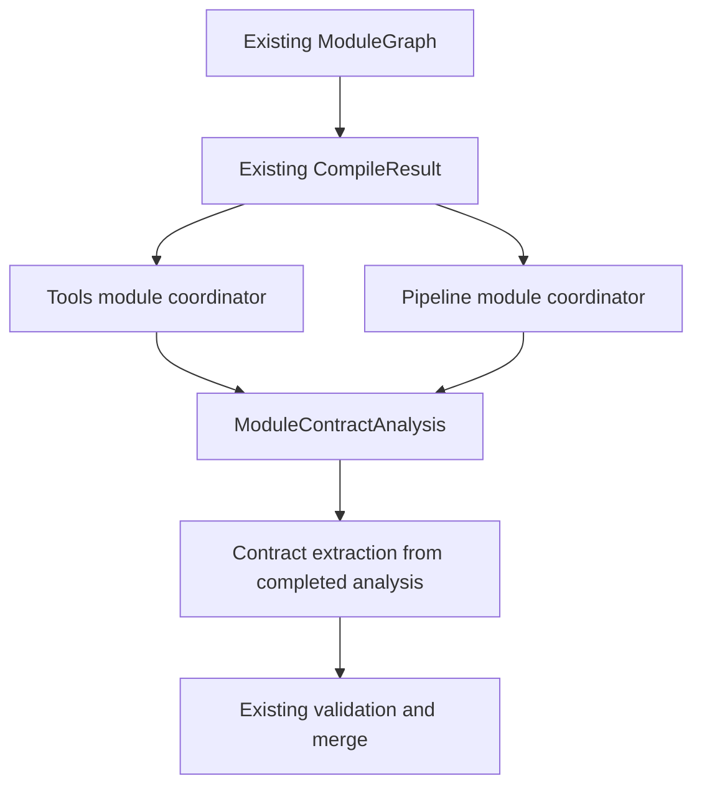
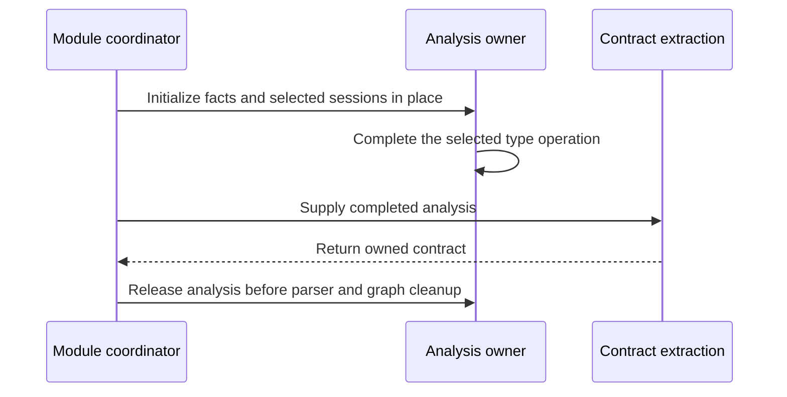
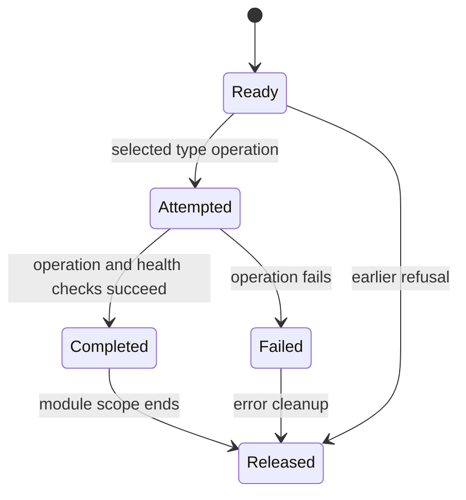
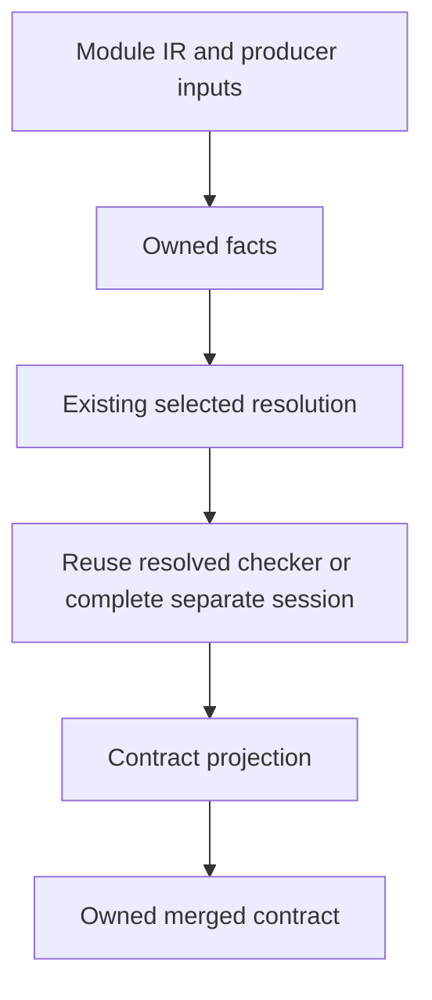
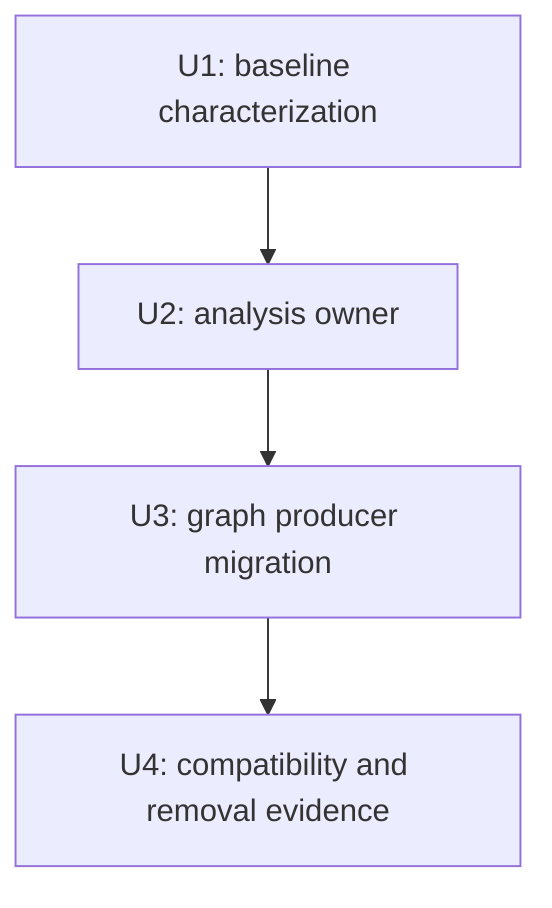

# Multi-module contract analysis - Plan

## Goal Capsule

The objective is to reduce the places maintainers must change when contract analysis changes for imported handlers.
The means is one owner for completed analysis used by both producers of multi-module contracts.
Product requirements govern behavior. Technical decisions govern the mechanism within those requirements.
The main agent owns implementation, review, verification, and local commits after the owner selects this plan.
The owner owns publication. The agent must not push.
An output difference, changed pass selection, or additional analysis authority stops the migration until the agent resolves the cause.

---

## Product Contract

### Summary

Both producers of multi-module contracts will consume completed per-module analysis for their default type-check paths.
Contract construction will no longer create analysis for those default private graph paths.
The custom callback keeps its existing compatibility path.
The producers will retain their distinct validation rules.

### Problem Frame

`buildMultiModuleContract` in tools creates contracts through a fallback type session.
`extractMultiModuleContract` in the pipeline owns resolution but still needs a fallback session for some modules.
Those separate paths distribute analysis production between coordinators and contract construction.
The completed single-module unit removed this responsibility from private contract construction for single-module handlers.

CHECK imports use different resolution, readers, preparation, depth limits, and failure rules from compilation imports.
CHECK also analyzes unoptimized IR. Compilation contracts consume optimized IR.
A direct replacement with the strict compilation graph would change existing outcomes.
This unit consolidates contract analysis first. It does not complete convergence between CHECK and compilation.

### Key Decisions

Preserve documented features. This decision governs R1, R3, and R7.
It is session-settled: user-directed, chosen over feature cuts to retain the accepted product surface.

Invest in shared analysis before a new typed frontend. This decision governs R5.
It is session-settled: user-directed, chosen over frontend replacement to remove duplicate analysis responsibility first.

Preserve initial wire formats. This decision governs R2.
It is session-settled: user-directed, chosen over artifact migration to keep compatibility during the reset.

### Requirements

**Compatibility**

- R1. Each producer retains its current diagnostics, errors, pass selection, type-map inputs, callback behavior, and acceptance rules.
- R2. Serialized contracts, dependency bytecodes, entry bytecode, and signed graph membership retain their exact baseline bytes and order.
- R3. CHECK retains its current revision reader, import traversal, partial results, cycle handling, depth limit, and classification behavior.

**Analysis ownership**

- R4. Each operation owns its analysis state and releases that state without introducing shared mutable state between requests.
- R5. Both private graph producers use one per-module analysis owner for default type checking. Their contract construction consumes completed facts and type sessions.
- R6. An incomplete or failed type session cannot supply contract extraction with a completed checker.

**Scope**

- R7. Multi-module compilation retains `DeclarationNotEnforced` and gains no verifier, flow, path generation, or declaration support.

### Acceptance Examples

A dependency with an invalid boolean condition still makes pipeline extraction return `SoundModeViolation`, including when strict mode is false.
This example covers R1.

A dependency that reads an environment variable still appears in the merged tools contract.
An excluding policy still causes `PolicyViolation`. These examples cover R1 and R2.

A revision-backed CHECK still reads its imported helper from that revision when the working tree differs.
A missing revision file still produces the current conservative result. These examples cover R3.

A custom type-check callback still runs at the same selected modules and stages.
An earlier refusal still prevents callbacks that the baseline did not reach. These examples cover R1 and R6.

### Scope Boundaries

The product edits are limited to `packages/zts/src/pipeline.zig` and `packages/tools/src/precompile.zig`.
Tests remain beside that code. Existing fixtures can change only to add baseline characterization.
The plan index, roadmap, and worklog record execution evidence.

#### Deferred to Follow-Up Work

CHECK import ownership and convergence with compilation require a separate bounded plan after this unit.
The follow-up must preserve contextual readers and distinguish unresolved flow summaries from blocked fault scans.
Sharing prepared dependency type maps, adding graph-wide flow, and accepting multi-module declarations require separate behavior decisions.
The typed frontend remains after shared-analysis work.

#### Considered and Not Built

A tolerant replacement for `ModuleGraph` would add resolution policies, edge outcomes, and traversal modes in this unit.
Its current consumers need different semantics, so this plan preserves the graph instead.
A CHECK cache would add retention and lookup code around an already shared imported-file constructor.
No measured maintenance benefit justifies that cache in this unit.
`CompileResult` remains a compilation product. CHECK must not depend on code generation or optimized IR.

---

## Planning Contract

### Key Technical Decisions

- KTD1. Use a per-module analysis owner in the curated pipeline surface, with two fixed producer profiles.
  Both current graph producers are consumers. The owner borrows parsed IR and owns analysis facts and type-session storage.
- KTD2. Initialize the owner in its final location before publishing borrowed pointers.
  `TypeChecker` borrows its environment and pool. The owner must not move while those borrows exist.
- KTD3. Preserve the pass matrix below, including the distinction between resolution and contract type checking.
  Reuse `TypeEnvStorage`, `buildModuleFacts`, `resolve`, and the completed-session extraction operation where their current behavior matches.
- KTD4. Keep source loading, graph order, code generation, serialization, SQL validation, policy checks, and contract merging in their existing owners.
  This avoids a new compiler framework and preserves the cleanup semantics of `CompileResult`.
- KTD5. Keep public extraction signatures and fallback behavior compatible.
  The new owner's extraction operation uses a completed checker and cannot start an unselected analysis pass.
  The custom callback retains `extractContractFromParsed` as an explicit compatibility branch after existing resolution.

The proposed owner name is `ModuleContractAnalysis`. The name does not require a new file or a new public configuration surface.
The owner needs no `CheckedModule`, verifier, or flow checker.
The existing single-module coordinator remains unchanged unless a mechanical call adaptation is necessary.

### Pass Matrix

| Producer and module | Resolution | Contract type session | Refusal rules | Facts |
|---|---|---|---|---|
| Tools, every compiled module | No boolean or strict pass | Fresh default session; no `TypeMap` | Preserve ignored type diagnostic count; allocation and health errors still propagate | Current builder inputs |
| Pipeline, entry with an effective `TypeMap`, default callback | Type, boolean, selected strict pass | Reuse the resolved checker | Preserve pre-extraction and post-extraction checks on the resolved checker | Separate resolution and contract inputs |
| Pipeline, entry without an effective `TypeMap` or dependency, default callback | Boolean and selected strict pass without a type checker | Fresh default session | Preserve existing resolution refusal; do not add refusal for the fallback's diagnostic count | Separate resolution and contract inputs |
| Pipeline, custom callback | Existing resolution first | Existing public fallback using the supplied callback | Preserve callback errors and existing checks on the resolved checker | Existing compatibility path |

Public extraction selects `frontend.typeMap() orelse opts.type_map` as the effective map.
The pipeline gives that map only to the entry, including an untyped entry with an explicit supplied map.
Prepared dependency maps remain unused by these consumers under R1.
The owner must not make boolean or strict checks type-aware when the baseline resolution has no type checker.
The pipeline's custom callback takes the compatibility path even when resolution already created a checker.
The callback receives the same root, environment inputs, service context, and module selection as the baseline.

Resolution facts retain the current null registry.
Contract facts retain the explicit `opts.module_facts` when supplied; otherwise, the owner builds them with the current manifest registry.
The owner retains separate indexes when inputs differ. It shares an index only when the inputs are identical.

### High-Level Technical Design

These sketches show responsibilities and lifetime constraints. They do not specify implementation code.

The owner borrows one compiled module. The owner does not retain a second graph or compiled product.

Only the completed state permits extraction under R6.
The owner exposes no successful retry after an attempted operation.

The pass matrix selects the resolution and session stages. Tools skips resolution.

### Evidence and Risks

`packages/tools/src/precompile.zig` defines the tools graph contract producer.
`packages/zts/src/pipeline.zig` defines the pipeline graph contract producer.
`packages/zts/src/pipeline.zig` defines extraction options and custom callback behavior.
`packages/zts/src/pipeline.zig` provides extraction from an explicit type session.
That helper currently rejects overridden callbacks and supplied resolution options.
The new owner retains that public guard. Default extraction clears the supplied resolution option after selecting its completed checker.
Custom extraction stays on the current compatibility branch.

`packages/zts/src/pipeline.zig` shows resolution without a type environment.
`packages/zts/src/pipeline.zig` shows the fallback environment populated with module types and handler ABI types.
Replacing both environments with one unconditional environment would change the pass matrix.

`packages/zts/src/modules/internal/compiler.zig` owns optimized parsers and generated constants.
Build callers free owned constant payloads before `CompileResult.deinit`. Runtime callers use a different lifetime.
KTD4 keeps this boundary intact.

Relevant lessons include `docs/solutions/architecture-patterns/separate-wire-compatibility-from-owned-domain-projection.md` and `docs/solutions/logic-errors/normalize-unions-without-dropping-members.md`.
The first lesson requires exact wire comparisons. The second requires stable borrowed storage and observable allocation failures.
`docs/solutions/conventions/difference-is-not-the-claim-and-a-probe-must-compile.md` governs mutation evidence.
The prior unit and its limits are recorded in `docs/plans/2026-10-11-shared-analysis-first-unit.md`.

No speed or deletion count is predicted. Those results need measurement.

---

## Implementation Units

### U1. Characterize both graph producers

The goal is to establish public baseline outcomes before ownership changes. This unit serves R1, R2, R3, and R7.
Files: tests in `packages/tools/src/precompile.zig` and `packages/zts/src/pipeline.zig`.
The agent will start with one tiny imported helper and capture both producer outcomes.
The agent will then extend the same fixture pattern without changing verification methods.

Test scenarios include typed and untyped entries, an untyped entry with an explicit `TypeMap`, a typed dependency, and imported capability merging.
They also include policy refusal and missing imports.
They also include fan-out and shared dependencies, imported routes, and declaration refusal before graph reads.
Callback scenarios cover typed entry reuse, untyped fallback, custom callback selection, and a callback error after successful resolution.
An invalid boolean dependency must preserve pipeline refusal with strict mode off.
A tools dependency with type diagnostics must preserve the baseline outcome instead of receiving a new refusal.

The agent will record exact contract JSON and dependency bytecode order for each producer separately.
Fixed filenames and metadata must make baseline comparisons repeatable.
The agent will retain existing CHECK import tests and revision isolation tests as compatibility evidence.
Verification: unfiltered `test-precompile` and `test-zts`, plus baseline artifact capture.
Execution note: characterization precedes product edits and gets its own local commit.

### U2. Add the stable analysis owner

The goal is one owner for the analysis selected by each graph producer. This unit serves R4, R5, and R6 through KTD1 to KTD3.
File: `packages/zts/src/pipeline.zig`.
The owner will construct each required facts index once, retain stable type storage, and record completion before exposing default extraction.
It will retain separate resolution and contract sessions only where the pass matrix requires both.
It will supply existing `ModuleFacts` to contract construction with the same registry semantics as the current builder.

Test scenarios include completed extraction, extraction before completion, analysis failure, repeated completion attempts, and cleanup after partial initialization.
Testing-allocator checks must expose leaks and invalid ownership.
Tests use the new analysis API for completion behavior and the public extraction API for compatibility.
Verification: unfiltered `test-zts`, `test-module-boundary`, `test-zts-layering`, and `test-proof-swallow`.

### U3. Migrate the two graph producers

The goal is to remove fallback production from both default graph contract paths. This unit serves R1, R2, R5, and R7 through KTD3 to KTD5.
Files: `packages/tools/src/precompile.zig` and `packages/zts/src/pipeline.zig`. This unit depends on U1 and U2.
The agent will replace default per-module analysis production with the owner and extract from its completed session.
Tools will keep entry AOT analysis before contract extraction. Tools will keep SQL and policy validation before each merge.
The pipeline will keep the existing refusal stages and entry-only options.
Both producers will retain execution-order iteration and per-module cleanup.

Test scenarios are the U1 producer fixtures, including custom callback errors and the ignored tools type count.
Exact baseline comparisons must include dependency ordering and merged contract bytes.
Verification: unfiltered `test-precompile`, `test-zts`, `test-zts-cli`, `test-contract-golden`, and `test-module-graph-record`.

### U4. Establish compatibility and removal evidence

The goal is evidence that the migration preserves behavior and removes the selected authority. This unit serves R1 to R7.
Files: the two product files for final cleanup, plus the plan index, roadmap, and a compact worklog.
This unit depends on U3.

The agent will run the full verification contract and review the product diff line by line.
The agent will perform a compiling mutation that skips a required type operation.
The unchanged public fixture must reject that mutation through a wrong expected result or an extraction refusal.
A separate compiling mutation will omit an imported module contract. The fixture must detect the missing capability or wrong artifact.
The agent will restore both mutations and rerun the affected unfiltered steps.
Safe controls must continue to pass, and every cited run must execute at least one relevant test.

The removal report will identify the deleted production sites and the new owner's two live consumers.
It will distinguish code reduction from relocated code and record allocation or retention changes observed on the tiny fixture.
No benchmark claim follows from an unmeasured change.
Independent review must examine the pass matrix, lifetimes, callback compatibility, and artifact order before completion.

---

## Verification Contract

All tests run unfiltered. Build output goes to a log, and the agent reads the build exit status directly.
`-Dtest-filter` and a pipeline through `tail` cannot supply acceptance evidence.
Existing goldens must not be regenerated to hide a compatibility difference.
The tiny public fixture runs first. A required script exceeding two minutes needs owner confirmation under repository instructions.

| Command or check | Scope | Required result |
|---|---|---|
| `zig build test-zts` | Pipeline analysis and graph extraction | All tests pass; relevant fixture count is nonzero |
| `zig build test-precompile` | Tools compile and CHECK paths | All tests pass; U1 scenarios execute |
| `zig build test-zts-cli` | Public analyzer dispatch | All tests pass |
| `zig build test-contract-golden` | Published contract outputs | Exact existing fixtures pass |
| `zig build test-module-graph-record` | Graph identity and ordering | All tests pass |
| `zig build test-module-boundary` | Curated exports | No new internal reach |
| `zig build test-zts-layering` | ZTS dependency tiers | No upward dependency |
| `zig build test-proof-swallow` | Analysis error handling | No unreviewed discarded error |
| `zig build test` | Runtime and CLI consumers, including revision-backed CHECK | Existing aggregate tests pass |
| Exact artifact comparison | Fixed paths and metadata for each producer | Baseline bytes and dependency order match |
| Compiling mutations | Required analysis and imported contract contribution | Both mutations produce failing relevant tests |

The aggregate `test` does not replace standalone `test-zruntime`.
This unit does not change runtime execution or constant ownership, so standalone runtime execution is outside its required check scope.
If an implementation needs those changes, the agent must stop and revise the plan before editing them.

---

## Definition of Done

U1 supplies baseline fixtures before ownership changes.
U2 supplies stable completed analysis with observable failure and cleanup behavior.
U3 makes both default graph producers consume that analysis without contract fallback production.
U4 supplies exact comparisons, compiling mutation results, independent review, and a responsibility removal report.
All requirements and required checks pass.
Abandoned implementations, unused interfaces, and duplicate private production sites are removed.
The agent commits each complete isolated unit on local `main` and does not push.
The worklog records remaining convergence work without claiming that CHECK and compilation share a completed graph analysis.
