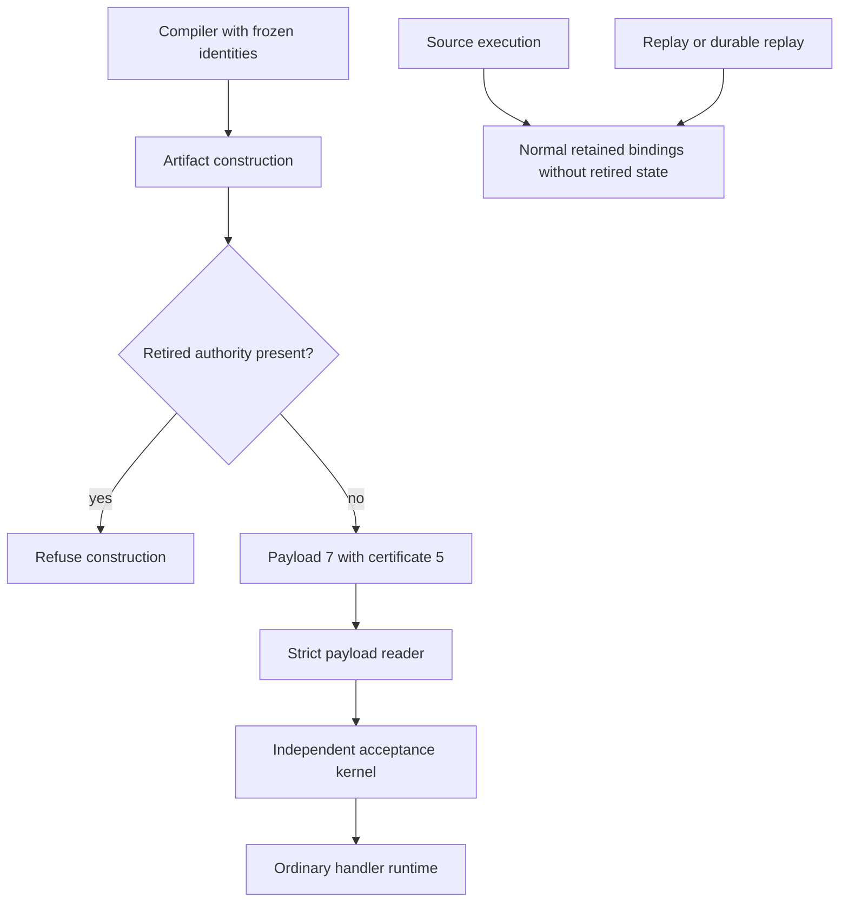
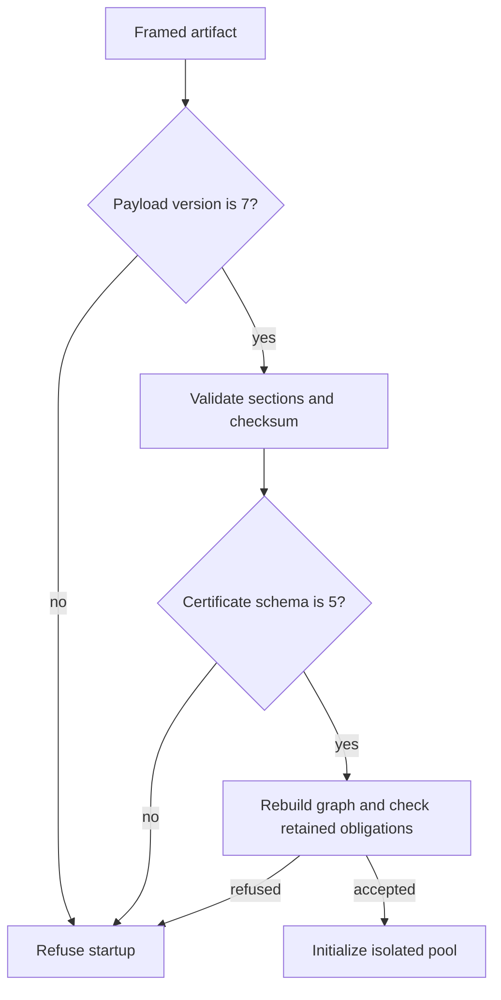

# Plan 005 Phase 2 Feature Removal - Plan

## Goal Capsule

Objective: Operators deploy and serve ordinary proven handlers without the retired tool-route, application-invariant, or consumer-declaration products.
Means: Remove runtime support and the three artifact sections under KTD1 and KTD2.
Authority: The origin's Phase 2 and the owner's Decision 10 authorize execution, including the artifact format change.
The Product Contract governs behavior. The Planning Contract governs mechanisms within those requirements.
Execution uses local `main`. The main agent owns review, verification, and local commits. The owner owns publication.
An identity change outside R5 or a surviving acceptance bypass stops the affected unit.

---

## Product Contract

### Summary

Remove the three optional artifact products together and retain the ordinary handler deployment path.
Remove the corresponding public runtime commands, configuration, adapters, examples, and documentation.
Keep the compiler's model-visible exports until the separately authorized Phase 3 identity change.

### Problem Frame

The three artifact products add producer, consumer, configuration, and runtime responsibilities outside the selected agent-compiler product.
The origin places their removal in Phase 2, after the completed Phase 1 cuts.
Deleting their compiler exports also changes frozen recording identities, which the origin reserves for Phase 3.

### Key Decisions

Decision 10 selects Phase 2 execution rather than closure of the completed shared-analysis work.
The decision is session-settled: user-directed, chosen over closing completed work because the owner selected further execution.
It governs R1, R2, R3, and R4.
The origin's accepted decisions 3, 4, and 5 establish the three removals. The origin remains their product authority.

### Requirements

**Retired products**

- R1. Tool and agent routes, authentication, credential injection, turns, recording, and their public runtime configuration leave the supported runtime.
- R2. Application invariants, their protected ledger activation, classifier, CLI, reports, and dedicated drift gate leave the supported runtime.
- R3. Consumer declarations and the vocabulary envelope leave artifact construction, activation, public configuration, and their dedicated tooling.

**Artifact compatibility and retained behavior**

- R4. New artifacts use payload format 7 and certificate schema 5. Readers refuse payload format 6 and certificate schema 4 explicitly.
- R5. Compiler bindings, registry order, rules, specifications, prompts, provider catalog, and frozen recording identities remain unchanged until Phase 3.
- R6. Retained exports cannot restore retired runtime authority through normal execution, source execution, replay, durable replay, or live reload.
- R7. Ordinary handlers retain all eight kernel properties, residual guards, graph binding, signing, attestation, request isolation, and path traversal checks.
- R8. Every surviving gate retains a nonempty subject and its demonstrated checks. A gate leaves only with its complete subject.

### Scope Boundaries

Phase 3 owns deletion of `zttp:ledger`, `zttp:tool`, their compiler rules, and other model-visible surfaces.
Phase 3 also owns orchestration, system linking, TSX, comptime, hypermedia, and the single DeepSeek re-record.
This phase calls no provider and edits no frozen recording identity to conceal a mismatch.
Bindings remain their existing implementations. This phase adds no compatibility binding, fallback mode, new proof property, or generic feature framework.
No file under `packages/pi/src/skills/` or `packages/pi/src/prompts/` changes.

### Acceptance Examples

AE1 (ordinary deployment) covers R4 and R7: a newly built ordinary handler carries format 7, passes acceptance, and serves its expected response.
AE2 (old artifact refusal) covers R4: a correctly framed format-6 artifact refuses before pool initialization and never discovers a source handler.
AE3 (retired authority refusal) covers R1, R2, and R6: a tool-bearing or ledger-bearing artifact refuses construction and activation.
AE4 (recorded authority refusal) covers R6: a recorded successful ledger or tool result cannot replace an absent-state refusal.
AE5 (frozen authoring replay) covers R5: the existing nineteen-case corpus replays offline under unchanged compiler and request identities.

---

## Planning Contract

### Key Technical Decisions

KTD1 (stage compiler identity removal). Keep the existing compiler and native bindings under R5, while removing their runtime state and grants under R6.
This follows the Phase 1 precedent that moved model-visible removals to Phase 3.
Decision 11 offers combined phases with recording authorization, but that broader work is not presumed authorized.

KTD2 (one artifact format transition). Remove payload sections 8, 9, and 10 and certificate invariant section 11 under R4.
Remove invariant identity and witness fields, then use the exact-version checks that already govern both codecs.
Keep `ProofSystem.zttp_pcc_v3`, the semantics epoch, and residual certificate section 10.
Retired wire, graph-member, stage, and reason numbers remain unused.

KTD3 (refuse before projection). A retained producer `ledger_call` becomes an explicit artifact-construction refusal, never an omitted proof operation.
Tool-bearing and invariant-bearing contracts also refuse before artifact output or activation under R6.
These guards prevent a retired authenticated route from becoming an ordinary HTTP route after its gate disappears.
Use one small shared predicate over existing contract facts, proof evidence, and configured removed authority.
Its inputs include module names, catalog entries, credentials, removed configuration, and `ledger_call` nodes.
Build, generated precompilation, source execution, pool initialization, bundle verification, and reload apply the same condition before effects or output.
The error names the unsupported runtime feature. It must not report corrupted source or silently ignore a configured obligation.

KTD4 (normal registration for retired exports). Replay and durable registration must not substitute recorded successes for ledger or tool calls under R6.
The existing bindings supply absence-of-state refusals. Runtime registration uses those bindings without the retired state or grants.
The implementation may refuse the affected import instead when that is the smaller existing boundary.

KTD5 (maintain retained gate subjects). Update source lists, mutant rows, release markers, and measured floors under R8.
Remove only mutant and allowlist rows whose complete subject leaves.
Count retained kernel files and executed tests before setting replacement floors.

### High-Level Technical Design

### Sources and Existing Patterns

`packages/runtime/src/self_extract.zig` owns artifact framing and strict format checks.
`packages/proof-checker/src/proof_system.zig` requires a schema bump for certificate layout changes.
`packages/proof-checker/src/certificate.zig`, `checker.zig`, and `executable_graph.zig` own the closed consumer formats and obligations.
`packages/runtime/src/proof_certificate.zig`, `artifact_graph.zig`, and `proof_activation.zig` connect the producer and consumer.
`packages/modules/src/data/ledger.zig` and `http/tool.zig` already refuse without active state or grants.
`packages/zts/src/modules/internal/resolver.zig` and `trace.zig` show why replay substitution needs the denial boundary.
`packages/pi/src/expert_codegen_record.zig` and `session/protocol_identity.zig` establish the frozen identity inputs.

`docs/solutions/security-issues/a-damaged-artifact-started-as-a-plain-runtime.md` supplies the artifact refusal rule.
`docs/solutions/conventions/a-file-split-proven-by-its-graph-broke-the-gates-that-read-it-as-text.md` supplies the text-consumer and release-marker checks.
`docs/solutions/conventions/a-gate-can-be-non-vacuous-and-still-porous.md` supplies the retained verdict and mutation obligations.

### Deferred Implementation Details

The implementation determines the smallest existing runtime registration boundary for KTD4.
The implementation measures retained kernel floors after deletion rather than guessing counts.
The implementation classifies every shared-file declaration or catalog field before deletion, because compiler-visible fields remain under R5.

---

## Implementation Units

### U1. Establish retired-authority refusal

Goal: Prevent the removed products from gaining runtime authority before their support leaves.
Requirements: R5, R6, and R7. Dependencies: none.
Runtime files: `packages/runtime/src/build_command.zig`, `proof_certificate.zig`, `proof_activation.zig`, `handler_instance.zig`, `runtime_cli.zig`, `live_reload.zig`, `proofs/bundle.zig`, and `zruntime_tests.zig`.
Producer and configuration files: `packages/tools/src/precompile.zig`, `project_config.zig`, and the smallest shared helper required by KTD3.
Files also include the minimum runtime module-registration seam reached from `handler_instance.zig`; KTD4 governs any resolver change.
Approach: Capture current ordinary-handler and identity baselines, then add the denial boundaries from KTD3 and KTD4.
Execution note: Establish public rejection tests before changing the corresponding authority paths.
Patterns to follow: Existing build errors, pre-pool activation refusal, and absent-state Result behavior.
Test scenarios:

1. A tool-bearing contract refuses artifact construction before any output artifact appears.
2. A retained producer ledger node refuses certificate construction instead of disappearing from the proof IR.
3. A feature-bearing candidate refuses activation before pool initialization or ordinary-route fallback.
4. Normal source calls to ledger and tool exports return their existing absent-state errors after installation is disabled.
5. A replay trace and a durable trace containing a successful retired operation cannot restore success through substitution.
6. An ordinary source handler and an ordinary accepted artifact retain their expected response.
7. `-Dhandler` precompilation refuses a ledger or tool application before writing its generated module.
8. Source replay, fixture tests, initial watch, and durable scheduling refuse a retired application before execution or pool initialization.
9. Bundle verification and live reload refuse retired contract facts; a failed reload preserves the previous generation.
10. Project discovery rejects declaration, invariant, authentication, and credential configuration rather than discarding its security intent.

Verification: Public refusal cases pass, ordinary behavior stays green, and observed compiler identities remain at baseline.

### U2. Remove public runtime products

Goal: Remove the runtime implementations and public surfaces behind the retired products.
Requirements: R1, R2, R3, R5, R6, and R7. Dependency: U1.
Files: Runtime tool, agent, credential, turn, SSE, and invariant implementation files reached from `server.zig` and `handler_instance.zig`.
Shared runtime files: `runtime_config.zig`, `runtime_cli.zig`, `dev_cli.zig`, `cli_help.zig`, `server.zig`, `live_reload.zig`, `runtime_pool.zig`, `contract_runtime.zig`, `build_command.zig`, and `zruntime_tests.zig`.
Tooling files: `packages/tools/src/project_config.zig`, `precompile_args.zig`, `precompile.zig`, `zts_cli.zig`, and the dedicated vocabulary-envelope command.
Configuration and build files: `build/Context.zig`, `artifacts.zig`, `host_tests.zig`, `runtime_tests.zig`, `proof_gates.zig`, and affected verification and release-marker lists.
Approach: Remove dedicated runtime code and adapters, public flags, configuration readers, examples under `examples/tools/`, and subject-only build steps.
Keep compiler-visible analysis and bindings as KTD1 requires. Remove installation paths after their U1 refusals are present.
Keep shared certificate construction in `proof_certificate.zig`; only its invariant-specific branches leave in U3.
Patterns to follow: The Phase 1 same-subject removal rule and existing public unknown-command or invalid-configuration errors.
Test scenarios:

1. Removed public commands and flags refuse rather than entering an obsolete adapter.
2. Removed configuration cannot activate ledger state, tool grants, credentials, agent turns, or consumer obligations.
3. Ordinary routing, static-file path checks, source reload, and request isolation retain their existing tests.
4. A refused reload leaves the current accepted generation and in-flight requests intact.
5. The frozen nineteen-case replay remains unchanged under R5.

Verification: No supported runtime path installs retired authority, dedicated subjects leave with their gates, and retained runtime tests pass.

### U3. Remove the three artifact sections

Goal: Make producers and consumers use the smaller, closed artifact format together.
Requirements: R4, R6, R7, and R8. Dependency: U2.
Kernel files: `packages/proof-checker/src/proof_system.zig`, `certificate.zig`, `executable_graph.zig`, `limits.zig`, `verdict.zig`, `checker.zig`, `root.zig`, and `test_root.zig`.
Deleted kernel files: `invariant.zig`, `tool_catalog.zig`, and `declaration.zig`.
Runtime files: `self_extract.zig`, `artifact_graph.zig`, `proof_certificate.zig`, `proof_activation.zig`, `build_command.zig`, `runtime_config.zig`, `runtime_cli.zig`, `contract_runtime.zig`, and `proofs/bundle.zig`.
Gate files: `packages/tools/src/proof_checker_mutants.zon`, `scripts/check-proof-checker.sh`, `proof-swallow.allow`, and any remaining subject-only invariant or vocabulary gate wiring.
Approach: Apply KTD2 to all writers, readers, graph builders, verdicts, promotion paths, and tests in one coherent change.
Remove graph kinds 17 through 20, stages 11 through 13, and their reason families without reusing the numbers.
Keep the eight property members and retained residual catalog unchanged.
Patterns to follow: Closed enum decoders, exact schema equality, existing corruption tests, and the retained proof-ratchet assertions.
Execution note: Strengthen immediate-predecessor tests to name format 6 and schema 4 explicitly before changing the codecs.
Test scenarios:

1. A format-7 ordinary artifact and schema-5 certificate round-trip with retained sections and graph members.
2. A correctly framed format-6 artifact refuses through public startup and bundle paths.
3. A schema-4 certificate refuses through the public checker with the rebuild diagnostic.
4. Retired section tags and graph kinds refuse as unknown values rather than decoding to defaults.
5. Duplicate, oversized, truncated, checksum-invalid, and checksum-repaired malformed payloads still refuse without source fallback.
6. Existing retained kernel mutants still reject their named defects.
7. The property and residual-guard ratchets still cover their full surviving subjects.

Verification: All explicit format checks pass, retained mutants reject, and ordinary signed artifact acceptance remains green.

### U4. Close removal evidence and documentation

Goal: Give the owner a complete record of the smaller runtime and its compatibility limits.
Requirements: R1 through R8. Dependency: U3.
Files: `docs/roadmap.md`, `docs/plans/README.md`, the Phase 2 worklog, runtime and embedding guides, CLI and artifact documentation, and source comments affected by removals.
Remove `docs/consumer-contract.md` and unsupported live documentation while retaining historical citations through `pre-rebase:` where needed.
Approach: Reconcile supported surfaces, record the deferred compiler-export cut, inspect the complete product diff, and measure actual file and line changes.
Patterns to follow: The Phase 1 worklog's exact scope, commands, exit statuses, and recount method.
Test expectation: No new tests for prose. Existing documentation, release-marker, and full verification checks supply the evidence.
Verification: All required checks pass, review limits are explicit, and the owner can distinguish completed removals from Phase 3 work.

---

## Verification Contract

Every test verdict comes from an unfiltered named step and the direct command exit status.
Verification uses private Zig caches and removes `DEEPSEEK_API_KEY` from the environment.
The first execution check is a small named kernel or codec step before the broad suites.
No benchmark claim follows from a deletion count.

| Check | Required outcome |
|---|---|
| `zig build test-proof-checker test-proof-checker-mutants test-proof-checker-purity` | Retained kernel accepts valid evidence, refuses defects, and remains a leaf. |
| `zig build test-proof-ratchet test-proof-ratchet-drift test-residual-guards-drift` | Eight properties and retained residual guards keep their closed checks. |
| `zig build test-cli test-server test-zruntime` | Public removals refuse, ordinary runtime behavior and isolation pass. |
| `zig build test-zts test-precompile test-zts-cli test-contract-golden` | Retained compiler outcomes, fixtures, and analysis ownership remain valid. |
| `zig build test-module-boundary test-zts-layering test-proof-swallow` | No unauthorized reach or unreviewed proof-error discard appears. |
| `zig build test-expert-app test-standin test-cassette test-simulator test-meta-drift` | Frozen compiler and request identities remain unchanged, and nineteen cases replay offline. |
| `zig build test-docs-drift test-doc-links test-step-coverage test-script-reachability test-release-check` | Live docs, steps, scripts, and release markers match surviving subjects. |
| `zig build` and `zig build test` | Complete binaries and aggregate tests pass. |
| `bash scripts/verify.sh` | All retained repository gates pass offline. |

Compare baseline and final `zts meta --json`, `zts spec-hash`, policy files, recording files, and model-visible source hashes.
Record intentional certificate and payload format differences separately from frozen compiler identities.
Perform compiling omission mutations for old-format refusal, retained acceptance, and replay denial before reporting completion.
Restore each mutation from an exact snapshot and rerun its unfiltered affected step.

---

## Definition of Done

All four units meet their verification outcomes. New artifacts use the new formats and refuse the immediate predecessors.
Removed runtime products have no activation path, including recorded-result substitution and live reload.
The smaller kernel preserves the eight-property and residual-guard authority boundaries.
Frozen identities remain unchanged and the current corpus replays offline without metadata rewriting or provider calls.
The worklog records actual deletion counts, direct exit statuses, mutations, review coverage, and deferred Phase 3 compiler removals.
Temporary probes, abandoned code, and unowned edits do not enter the commits.
Local commits contain only this work. Publication remains the owner's action.
