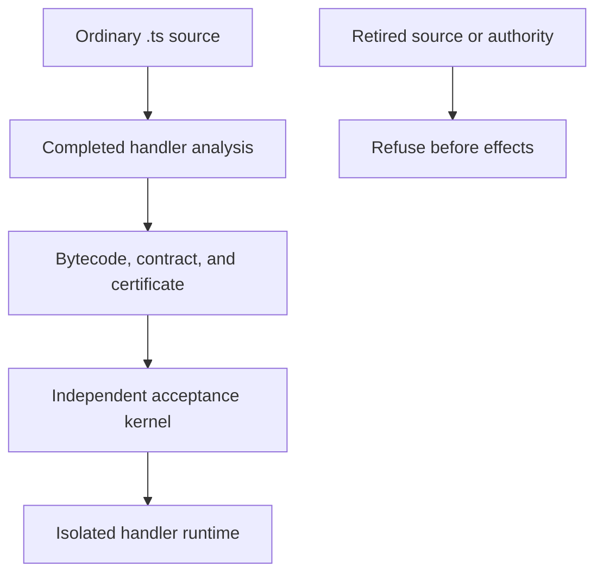
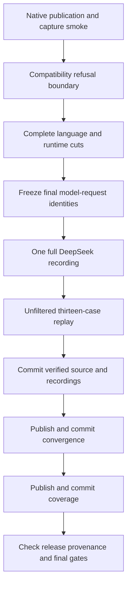

# Plan 005 Phase 3 Language Reset - Plan

## Goal Capsule

Objective: Developers author and deploy ordinary proven handlers through a smaller supported language and runtime.
Means: Apply the selected Phase 3 removals and migrate the measured corpus under KTD1 through KTD5.
Authority: The origin's accepted decisions govern scope. The owner's "go ahead with phase 3" authorizes execution and the necessary DeepSeek recording.
Execution uses local `main`. The main agent owns review, checks, and local commits. The owner owns publication outside the repository.
A retained acceptance bypass, incomplete recording, or unsupported change to a retained feature stops the affected work.

---

## Product Contract

### Summary

Remove orchestration, system linking, TSX, source `comptime()`, and hypermedia affordances from the supported product.
Complete the model-visible removals deferred from Phases 1 and 2.
Record the thirteen retained DeepSeek cases against the completed language change, then publish convergence and coverage.

### Problem Frame

The selected features add execution paths and compiler contracts outside ordinary handler authoring and independent acceptance.
Their removal changes model-request identities, so existing headline recordings cannot establish the new language's behavior.

### Key Decisions

The origin's decision 2 selects full orchestration and system removal over retaining durable workflows or the full orchestration product.
The decision is session-settled: user-approved. It governs R1 and R5.
The origin's decision 6 selects removal of TSX, comptime, and hypermedia over retaining TSX. It is session-settled: user-approved.
That decision governs R2 and R5.
The accepted Phase 1 and Phase 2 staging boundaries defer model-visible removals to this recording window. They govern R3 and R5.

### Requirements

**Supported product**

- R1. Remove durable workflows, queues, scope collection, parallel I/O, system linking, rollout, service dispatch, and their public configuration and examples.
- R2. Admit ordinary `.ts` sources without TSX lowering, special `comptime()` folding, global `resource()` affordances, or the HTMX init template.
- R3. Remove the eight selected virtual modules and the model-visible tools, persona references, diagnostics, and qualification product deferred from earlier phases.
- R4. Preserve ordinary routing, HTTP, SQL, validation, cache, replay, isolation, signing, attestation, proof tooling, sound checks, and the three binaries.

**Compatibility and evidence**

- R5. Perform all model-visible changes before one complete DeepSeek recording of the thirteen retained cases with a 600000-millisecond turn timeout.
- R6. Preserve independent acceptance, all eight kernel properties, and the residual catalog. Retired authority must refuse before effects or pool creation.
- R7. Keep payload format 7, certificate schema 5, and semantics epoch 1. Retire graph ordinal 10 without reusing any retired ordinal.
- R8. Require thirteen completed offline replay cases and thirteen checked runtime intents. Report measured failures without changing identities to conceal them.
- R9. Preserve demonstrated gate checks, measure surviving floors, and publish convergence before coverage from clean source with accurate provenance.

R3 selects `zttp:ledger`, `zttp:tool`, `zttp:durable`, `zttp:workflow`, `zttp:queue`, `zttp:scope`, `zttp:io`, and `zttp:service`.
The deferred tool list comes from `docs/plans/2026-10-11-feature-removal-phase-1.md`, under "Deferred to Phase 3".
It includes review-patch, build and test escapes, witnesses, memory, extension catalog, query ratchet, and their slash commands and dedicated implementations.
Qualification and its two dedicated Python scripts also leave under that plan's explicit Phase 3 deferral.

### Scope Boundaries

The local provider stays. Its parked recordings remain unchanged as historical artifacts and do not establish current replay compatibility.
Saved sessions stay. An old protocol identity must refuse resume before provider initialization; a new session must work.
PI's session ledger and the deployment proof ledger stay. They are distinct from the retired `zttp:ledger` module.
`upgrade_verifier.zig` stays because live reload still uses it. Ordinary fetch deadlines and outbound I/O also stay.
Shared `h` and `renderToString` stay; R2 removes their optional source frontend and resource product.
Phase 4, further shared-analysis convergence, new provider selection, performance optimization, and local re-recording remain outside this execution.
No tombstone module registry, language escape mode, recording bypass, or general publication framework enters this phase.

### Acceptance Examples

AE1 (ordinary deployment), covering R4 and R6: a new `.ts` handler builds, passes independent acceptance, and serves the exact expected response.
AE2 (retired authority), covering R1, R3, and R6: an old source, configuration, contract, or artifact cannot restore the retired execution paths.
AE3 (source admission), covering R2: `.tsx` and raw JSX refuse; an ordinary `.ts` call and a declared function named `comptime` remain valid.
AE4 (closed graph), covering R7: graph member 10 refuses, while retained kinds and their required commitments remain checked.
AE5 (recording migration), covering R5 and R8: old request identities refuse replay, and every new retained recording replays under its captured request checkpoints.
AE6 (honest publication), covering R9: filtered, incomplete, dirty, malformed, or stale evidence cannot replace the generated measurement pages.

---

## Planning Contract

### Key Technical Decisions

KTD1 (refuse before projection). Extend `retired_authority` and its existing consumers before deleting runtime state or compiler contract fields.
The project reader must refuse `durableDir`, configured systems, and formerly automatic `system.json` discovery instead of silently serving a subset.
Legacy contract fields that carry retired obligations must refuse before projection discards them.
Removed source imports use the existing unknown-module diagnostic; compatibility guards do not register replacement modules.

KTD2 (one atomic language migration). Keep the coupled compiler, runtime, authoring, identity, and recording work together until required checks pass.
Intermediate old-cassette refusal is expected evidence of changed request identities, not a reason to relax the replay gate.
The normal recorder permits an uncommitted source tree. Freeze that tree during recording, then verify and commit the complete source-and-recording result.
Publication uses the resulting clean commit; qualification's separate clean-source restriction does not govern the normal recorder.

KTD3 (retain wire layout, narrow the alphabet). Remove the producer's retired `ledger_call` and TSX graph member without changing serialized record shapes.
The frontend member was optional and only appeared when a source frontend existed. Retained graph ordinals keep their exact values.
Preserve core grammar and opcode semantics identities. Measure any unexpected change before accepting it.
Preserve surviving native state slot numbers and the existing array size. Deleted owners cannot receive new assignments.

KTD4 (native evidence tooling). Replace the touched Python marker extractor and publication bodies with narrow Zig commands under the existing shell entry points.
Preserve their validation, canonical hashes, nonempty floors, source checks, table placement, and publication failure behavior.
First preserve the current nineteen-case cohort; change its explicit floors with the final thirteen-case source list under R8.
This replacement is necessary because repository instructions prohibit extending Python in the touched publication area.
Keep the uniqueness gate over actual producers and consumers, with tests for the native consumer's complete inputs.

KTD5 (record once, preserve failures). Validate capture, storage, request identity, and replay through a dedicated provider-free, unfiltered smoke step.
Move or reuse the existing loopback capture scenario through public APIs; do not add production exports solely for tests.
After the complete identity change, run the existing full recorder without corpus limits or tool filters.
Its test selector starts generation only. Unfiltered offline replay provides the verification verdict and must satisfy R8.
Update outcome pins only from the newly recorded observations. A timeout or missing artifact must remain an explicit failure.

### High-Level Technical Design

### Sources and resolved compatibility facts

`retired_authority.zig` already protects build, precompile, activation, replay, bundle verification, and reload.
`live_reload.zig` still calls `zts_cli.upgrade_verifier`; the runtime census's proposed deletion of that helper does not apply.
`executable_graph.zig` owns frontend ordinal 10. `artifact_graph.zig` emits it only for a frontend-bearing source profile.
`proof_system.zig` requires a schema bump for layout changes. This phase changes the accepted graph alphabet, not record layout.
`session/protocol_identity.zig` binds persona, tools, and compiler identities. The existing loader refuses incompatible saved sessions.
`expert_codegen_record.zig` defaults to DeepSeek; currentness gates do not require the parked local corpus.
`tooling/release_provenance.zig` permits only generated evidence paths after a measurement's source commit.
All other documentation and worklog changes must therefore precede the final clean source commit used for publication.

The gate lessons in `docs/solutions/conventions/` require source-path reader searches, runtime-loaded inputs, nonempty floors, and compiling omission probes.
Relevant records are `a-file-split-proven-by-its-graph-broke-the-gates-that-read-it-as-text.md` and `a-gate-that-embeds-its-input-list-ran-the-list-it-was-built-with.md`.

### Deferred implementation details

Measure retained test, diagnostic, rule, module, and example counts after the cut. Do not derive new quality thresholds by subtraction.
Pin the existing public unresolved-name diagnostic for bare `comptime(...)` from a compiling public test.
Measure old ordinary artifact behavior under the new identities. Compatibility must never become source fallback or partial activation.
The native publication commands may share a small parser where both current publishers need identical validation.

---

## Implementation Units

### U1. Establish Phase 3 refusal

Goal: Refuse the selected retired authority before any supporting runtime path leaves.
Requirements: R1, R3, R4, R6. Dependency: U2.
Files: `packages/tools/src/retired_authority.zig`, `project_config.zig`, `precompile.zig`, and the affected runtime build, activation, CLI, bundle, reload, and test files.
Approach: Apply KTD1 to the six additional module names and the old project configuration paths.
Keep current compiler bindings and metadata during this unit so ordinary baselines remain replayable.
Execution note: Strengthen public refusal tests and observe their compiling failures before changing the predicate or readers.
Patterns: The Phase 2 shared predicate, pre-pool refusal, unchanged generated-output test, and failed-reload generation retention.
Test scenarios: retired imports refuse build and precompile; configured or automatic systems refuse discovery; rejected replay and reload cause no effects.
An ordinary handler still serves its expected response, and failed reload preserves its current generation and in-flight requests.
Verification: Unfiltered project, precompile, CLI, server, runtime, proof, boundary, and swallow checks pass. Metadata still equals the baseline.

### U2. Replace touched evidence tooling

Goal: Keep the existing evidence and capture pipeline usable without Python before the model-visible migration.
Requirements: R4, R5, R8, R9. Dependencies: none.
Files: Native commands under `tooling/`, their build wiring, `scripts/update-convergence.sh`, `update-coverage.sh`, `test-evidence-marker.sh`, and `check-convergence-emitter.sh`.
Files also include deletion of `scripts/extract-evidence-marker.py` and a dedicated recorder-smoke root under `packages/pi/src/`.
Approach: Apply KTD4 and KTD5 with current cohort expectations and existing public fixture behavior.
Preserve shell command names. Keep generated documentation destinations fixed and test outputs in private temporary paths.
Execution note: Capture accepted legacy fixtures and all current rejection cases before replacing the readers and writers.
Patterns: `tooling/release_provenance.zig`, `tooling/coverage_union.zig`, existing marker probes, and the existing loopback capture scenario.
Test scenarios: valid markers preserve their canonical digest; duplicate, incomplete, dirty, filtered, or malformed markers refuse.
A failed producer, moved source, invalid table, or inconsistent pair of outputs cannot publish a success claim.
The dedicated smoke captures a response, stores its cassette, verifies request identity, and replays through production APIs without a provider.
Verification: Unfiltered native publisher, marker, recorder-smoke, emitter, release-marker, script-reachability, and step-coverage checks pass.
Public fixture outputs match the current publisher where the input and source identity are identical. No model-visible identity changes in this unit.

### U3. Complete the language migration and recording

Goal: Deliver the smaller supported language and runtime with a complete current DeepSeek corpus.
Requirements: R1 through R9. Dependencies: U1 and U2.
Files: The selected native modules and specifications; compiler registry, contract, extraction, type, flow, frontend, resolver, and proof-IR files.
Runtime files include handler installation, runtime HTTP, server, pools, configuration, CLI, test runner, artifact graph, and their dedicated orchestration and dispatch files.
Tools files include precompile, project discovery, system commands, authoring protocol, diagnostics, canonicalization, and generated goldens.
PI files include the deferred tools, persona and skill references, system proof tool, protocol identity, stand-in seeds, corpus, recorder, and recordings.
Build files, scripts, allowlists, examples, and live documentation leave or change only with their actual subjects.
Approach: Apply KTD2 and KTD3 across the coupled source change, then update deliberate identity pins and recorded outcomes under KTD5.
Remove the eleven module implementation files and eight specifications identified by the census. Retain unrelated native exports and their slot numbers.
Remove system linker and service typing, saga and fan-out extraction, TSX lowering, comptime folding, and resource affordances.
Remove ZTS509, ZTS510, ZTS513, and the deferred dead ZTS755 through ZTS760 variants. Retain ZTS511, ZTS512, and ZTS514.
Remove the deferred authoring tools and qualification product before final recording. Keep local recordings unchanged and label them historical.
Remove exactly the six cases listed below. Preserve retained case prompts and starting workspaces unless direct compiler evidence requires a documented correction.
Freeze the resulting model-visible source. Record once, reconcile measured pins, then run the full offline replay and remaining verification.
Source and current recordings form one atomic migration unit. Do not commit a failing replay or claim a source-only intermediate state is complete.
Execution note: Establish source, import, graph, and ordinary-runtime behavior tests before the relevant production cuts.
Old cassette refusal is a required migration observation. New recordings must replace it through the live recorder, not metadata editing.
Patterns: Registry absence diagnostics, `.ts` admission, exhaustive kernel decoders, graph binding, source protocol mismatch, and current cassette activation.
Test scenarios: all eight removed imports report ZTS206; `.tsx` reports ZTS052; raw JSX refuses; declared `comptime` behaves as an ordinary function.
Bare unbound `comptime` and `resource` refuse through existing public diagnostics. Ordinary calls and shared HTML rendering remain valid.
Old graph member 10 refuses, retained member checks remain load-bearing, and no old feature regains authority through an artifact or replay.
Old saved sessions refuse resume before provider initialization. New sessions, external agent transport, stand-in, and handler authoring still work.
Ordinary fetch controls, SQL, cache labels, routing, path traversal, signing, panic isolation, and pool reuse preserve their current behavior checks.
Verification: All named compiler, native module, contract, authoring, runtime, proof, corpus, documentation, and boundary checks pass.
The dedicated smoke passes before provider spending. The new thirteen-case corpus replays offline with thirteen checked intents and no missing recording.
Run the full offline verification script, inspect the complete diff, finish native reviews, and commit the verified source and recordings.
All non-generated documentation and closure records must enter that final source commit before U4 begins.

### U4. Publish convergence

Goal: Publish the measured first-draft and intent outcomes for the retained corpus.
Requirements: R8 and R9. Dependency: U3.
Files: `docs/convergence.json` and `docs/convergence.md` only.
Approach: Run the existing convergence entry point against the clean verified migration commit under KTD4.
Review the complete generated data, case count, cohort identities, measured failures, and source provenance before its isolated local commit.
Test expectation: The native publisher and full offline replay provide the behavior checks; generated pages need no duplicate unit tests.
Verification: The command exits 0, represents all thirteen cases, and records the clean source commit it actually measured.

### U5. Publish coverage and close provenance

Goal: Publish the retained rule coverage and leave a current, clean release tree.
Requirements: R8 and R9. Dependency: U4.
Files: `docs/coverage.json` and `docs/coverage.md` only.
Approach: Run the existing coverage entry point from the clean convergence commit, then review and commit its generated outputs.
The coverage source commit may differ from convergence only by the permitted generated evidence changes.
Test expectation: Existing publisher, rule-seed, provenance, release, and aggregate checks provide the evidence.
Verification: Publication exits 0, all retained rules have honest accounting, and release provenance accepts both source commits.
Run final required gates from the clean tree without new source edits. The owner can then review and publish the local commits.

---

## Verification Contract

All verdicts use unfiltered named steps and direct exit status. Logs and Zig caches stay outside the repository.
Offline checks remove `DEEPSEEK_API_KEY`; only the explicitly authorized full recorder receives the existing credential.
No numerical deletion, performance, coverage, or quality claim appears without a measured subject.

| Check | Required outcome |
|---|---|
| Native publication and recorder-smoke steps | Complete inputs accept, invalid inputs refuse, and capture and replay work without a provider. |
| `test-zts`, `test-modules`, `test-module-governance`, `test-precompile`, `test-zts-cli`, `test-contract-golden` | Retained language works and removed language and modules refuse. |
| `test-cli`, `test-server`, `test-zruntime` | Ordinary runtime behavior, isolation, and retired-authority refusal pass. |
| `test-proof-checker`, `test-proof-checker-mutants`, `test-proof-checker-purity`, `test-proof-ratchet` | Eight properties, retained graph commitments, and every retained mutation remain checked. |
| `test-proof-ratchet-drift`, `test-residual-guards-drift`, `test-module-boundary`, `test-zts-layering`, `test-proof-swallow` | Closed proof and module boundaries retain complete subjects. |
| `test-diagnostic-corpus`, `test-flow-census`, `test-standin` | Retained diagnostics and advertised rules have measured producers and refusal coverage. |
| `test-expert-app`, `test-cassette`, `test-simulator`, `test-meta-drift` | Thirteen current cases replay, saved sessions refuse stale identities, and pins match actual registry changes. |
| `test-docs-drift`, `test-doc-links`, `test-release-check`, `test-step-coverage`, `test-script-reachability` | Documentation, markers, build steps, and scripts match their surviving subjects. |
| `zig build`, `zig build test`, `bash scripts/verify.sh` | Binaries and complete per-commit verification pass. |
| Release evidence provenance and applicable release checks | Both publications are complete, clean, current, and derived from permitted source changes. |

The removed cases are `durable-order`, `workflow-nested-dispatch-avoidance`, `workflow-queued-call`, `workflow-saga-compensation`, `workflow-wait-signal`, and `parallel-secret`.
The first eight retained cases are `health`, `validate-body`, `jwt-auth`, `weather-egress`, `sql-users`, `log-timestamp`, `cache-counter`, and `egress-options`.
The remaining five retained cases are `sibling-helper`, `health-holes`, `cache-counter-holes`, `egress-options-holes`, and `sibling-helper-holes`.

Compare metadata, specifications, policy, module, diagnostic, restriction, example, persona, and protocol identities before and after the cut.
Review every moved pin against its actual owning source. Core grammar and opcode semantics hashes remain unchanged unless evidence disproves that expectation.
Perform compiling omission probes for retired-authority refusal, frontend graph rejection, and ordinary accepted execution.
Restore each exact snapshot and rerun its unfiltered affected step before final source closure.
Keep final measurement commits limited to the four generated paths that `release_provenance.zig` permits.

---

## Definition of Done

Every selected product and deferred model-visible subject is removed with its dedicated tests, gates, examples, and live documentation.
Retained handlers pass public behavior checks and independent acceptance. No removed authority activates through source, artifacts, replay, or reload.
The eight kernel properties, residual catalog, retained graph ordinals, and native state owners retain their enforced boundaries.
One complete DeepSeek recording supplies thirteen current cases; the full offline replay checks thirteen runtime intents.
Convergence and coverage represent observed outcomes, including failures, and pass clean-source provenance checks.
All required checks pass, every source change has root review, and review limits are recorded without fabricated tool receipts.
No temporary mutation, abandoned implementation, generated cache, demo, or credential enters a commit. Local `main` is clean and nothing is pushed.
