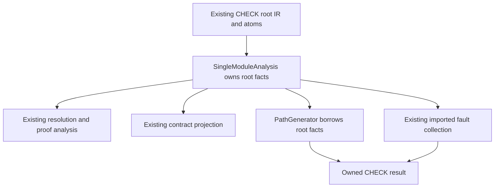
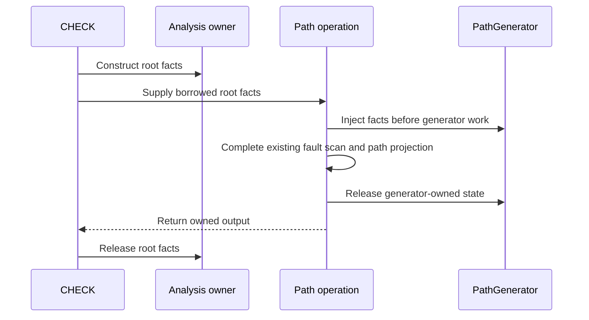

# CHECK facts reuse - Plan

## Goal Capsule

CHECK is the handler analysis exposed by `zts check`.
Objective: developers receive the same CHECK verdicts during the compiler reset.
Means: reuse the completed root import facts during path analysis, as defined by KTD1 (reuse the existing facts).
Authority: the current retained product and the accepted reset decisions govern this plan.
This plan delivers the first bounded unit of Phase 4, not the complete compiler reset.
The main agent owns implementation, review, checks, and isolated local commits on `main`.
The owner owns publication. No push is part of this work.

Execution starts with public characterization and a small fixture before broader checks.
Execution stops if facts differ, reader requests change, or successful results retain borrowed storage after its owner ends.
Execution also stops if the change adds another analysis owner or requires a source-language or wire-format change.

---

## Product Contract

### Summary

CHECK path analysis will consume the root import facts that its existing analysis owner already produced.
This change removes a duplicate facts producer. It does not combine the imported-file traversals.

### Problem Frame

The completed single-module unit shares analysis between CHECK and compilation.
The completed multi-module unit shares default contract analysis between both graph producers.
CHECK still constructs its root `ModuleFacts` twice.
`SingleModuleAnalysis.initFull` constructs the first value. `PathGenerator.importFacts` constructs the second during `analyzeHandlerPaths`.
Both values use the same root IR, atom table, and null manifest registry.

`PathGenerator.facts` already accepts a borrowed value.
Reusing that input removes an existing responsibility without adding an abstraction.
The separate imported flow and fault traversals have different stopping rules and observable reader calls.
Sharing loaded dependency results would require a separate compatibility decision.

### Requirements

**CHECK compatibility**

| ID | Requirement |
|---|---|
| R1 | Public CHECK diagnostics, stage sets, properties, paths, policy results, proof traces, and serialized contracts retain their current successful outcomes. |
| R2 | Each imported-file reader retains its current paths, invocation order, invocation count, and revision selection. |
| R3 | Early refusal, `skip_contract`, missing-handler behavior, and unsupported-import behavior retain their current outcomes. |

**Analysis and ownership**

| ID | Requirement |
|---|---|
| R4 | CHECK path generation and imported fault scanning consume the existing root facts. They do not construct another root facts value. |
| R5 | The existing analysis owner retains the root facts until every path consumer finishes. Returned results own any data needed after CHECK returns. |
| R6 | Allocation failures retain existing conservative or error outcomes. No failure becomes a completed proof, and cleanup releases every owned allocation. |

**Retained boundaries**

| ID | Requirement |
|---|---|
| R7 | Compilation paths, public options, artifact formats, certificate formats, the independent acceptance kernel, and runtime isolation remain unchanged. |

### Acceptance Examples

AE1 (repeated reader calls): CHECK imports two functions from one file through a tracing reader.
The migrated CHECK requests the same paths in the same order and with the same count as the baseline.
The returned proof properties and contract match the baseline. This example covers R1 and R2.

AE2 (failed dependency): an imported helper is missing, malformed, or unavailable at the selected revision.
Flow retains its unresolved result. Fault coverage retains its explicit blocked result.
Neither consumer treats the missing result as clean. This example covers R1, R2, R3, and R6.

AE3 (borrowed facts): CHECK returns a contract with imported fault provenance and generated path data.
The caller can inspect and serialize that result after the CHECK analysis owner has ended.
Result cleanup releases its allocations without freeing another owner's facts. This example covers R5 and R6.

### Scope Boundaries

Product edits stay in `packages/tools/src/precompile.zig`.
Relevant tests stay beside the affected code.
Existing public `PathGenerator` tests in `packages/zts/src/path_generator.zig` remain compatibility evidence.
The existing injected-facts mechanism needs no redesign.

#### Deferred to Follow-Up Work

Phase 4 later addresses remaining imported analysis duplication, separation of binding semantics, and a direct typed frontend prototype.
Runtime ownership and performance measurements follow those compiler units.
Each later unit needs a bounded plan against the then-current source.

Full loaded-graph reuse between CHECK and compilation remains deferred.
A later proposal must resolve `ImportReader` snapshot behavior before it changes repeated dependency reads.
This unit does not restore TSX, source `comptime()`, orchestration, or other removed features.

#### Considered and Not Built

A dependency cache would change an arbitrary reader's call count and could change the bytes that each analysis sees.
A generic import traversal would need both existing policy sets and would not remove either responsibility.
Neither mechanism belongs in this unit.
New source-digest records, proof wire fields, completion enums, and analysis profiles have no required consumer here.
The existing owners and completion states remain sufficient.

---

## Planning Contract

### Key Technical Decisions

KTD1 (reuse the existing facts): make root facts a required borrowed input to the private `analyzeHandlerPaths` operation.
The CHECK caller supplies `analysis.facts()`.
The path operation injects that value before any generator work and supplies the same value to imported fault collection.
This decision serves R4 and R5 through the existing `PathGenerator.facts` mechanism.
An optional private fallback would retain the duplicate authority and is excluded.

KTD2 (preserve reader semantics): retain both imported traversals, their loading operations, and their result ownership.
This decision serves R2, R3, and R6.
Missing flow summaries and blocked fault records retain their different meanings.

KTD3 (measure the bounded change): compare the same small public CHECK fixture before and after migration.
The comparison records public output and allocator calls, allocated bytes, and retained bytes.
No fixed allocation count becomes a permanent test assertion.
Source review must confirm that the CHECK path no longer invokes the private root-facts fallback.
This decision serves R1, R4, and R6. No speed or deletion percentage is predicted.

### High-Level Technical Design

CHECK optimizes its root IR before it constructs the facts.
The later path operation receives that same IR and atom table.
The imported-file loader has its own current preparation rules, which this unit preserves.

The facts use the main allocator. Path state can use the separate path allocator.
Borrowing does not transfer allocator ownership.
The path operation must finish before the analysis owner's destructor runs.

### Research and Constraints

The source baseline is `1bae15bb8b4c7bb36995e698d7e35d9a94b861d4` on local `main`.
The baseline includes the 0.22.0 evidence publication.
The completed graph contract unit is documented in `docs/plans/2026-10-11-multi-module-analysis-worklog.md`.

The current sources are `SingleModuleAnalysis`, `analyzeHandlerPaths`, and `runCheckOnPreparedSource` in `packages/tools/src/precompile.zig`.
`PathGenerator.resolveFacts` and its destructor in `packages/zts/src/path_generator.zig` define the existing borrowed-input behavior.
`RevisionReader` and `checkSides` in `packages/runtime/src/proofs/pr_gate.zig` define revision-backed CHECK behavior.
`RevisionReader` does not maintain a proof read set.

The implementation uses native Zig errors, stable caller storage, public API tests, and unfiltered checks.
No Python, provider changes, paid recording, runtime redesign, or new module-boundary reach is needed.

The import-polarity lesson is `docs/solutions/security-issues/a-missing-import-entry-was-conservative-for-one-proof-and-clean-for-another.md`.
The root-completeness lesson is `docs/solutions/security-issues/a-dispatched-route-was-never-walked-so-its-leak-proved-clean.md`.
The gate lesson is `docs/solutions/conventions/a-gate-can-be-non-vacuous-and-still-porous.md`.
These lessons support preservation and meaningful probes. They do not authorize another proof-authority mechanism.

### Repository Recount

The following values count tracked Zig files under `packages/` at the source baseline.
Physical lines include tests, comments, blank lines, and package build files. They do not measure removable production code.

| Package | Files | Physical lines |
|---|---:|---:|
| modules | 22 | 6,975 |
| pi | 131 | 72,022 |
| proof-checker | 14 | 8,311 |
| proof-review | 10 | 2,610 |
| runtime | 78 | 45,864 |
| tools | 34 | 34,314 |
| zts | 165 | 155,657 |
| zttp-sdk | 21 | 1,771 |
| Total | 475 | 327,524 |

The original audit measured a different baseline. Its TSX, orchestration, and AOT references are historical.
Current source and the accepted removals govern this plan.

### Deferred Implementation Details

The executor selects the private parameter name and the smallest tracing-reader fixture.
The executor measures allocator differences rather than estimating them.
The executor chooses a compiling mutation that makes the relevant facts-dependent behavior wrong.
There are no unresolved product decisions required to start this bounded unit.

---

## Implementation Units

### U1. Characterize CHECK inputs and output

Goal: establish public compatibility before changing the producer.
Requirements: R1, R2, R3, R5, and R6.
Dependencies: none.
Files: `packages/tools/src/precompile.zig`, with tests beside the public CHECK entry points.

Approach: add the missing reader-trace characterization through `runCheckOnlyFromSourceWithOptions`.
Existing fixtures cover proof roots, stages, malformed imports, depth limits, and revision selection.
Additional tests must cover missing behavior, not repeat that existing set.
Private temporary artifacts retain exact public outputs and the allocation measurement for the same small fixture.

New test:

Covers AE1. Two imported names use one tracing reader.
Exact path requests, order, count, proof properties, and contract output match the baseline.

Existing regression evidence, without duplicate tests:

| Behavior | Existing test in `packages/tools/src/precompile.zig` |
|---|---|
| AE2: missing dependency | `a sibling that does not exist blocks fault_covered` |
| AE2: malformed dependency | `an imported helper whose file will not parse leaves the secret unproven`; `a sibling that does not parse blocks fault_covered` |
| Stage stops | `default check records its exact public stage set`; `skip_contract stops after the exact computed stage set` |
| Routed unsafe handler and clean control | `router property census observes direct and routed violations for every obligation`; `router public checks prove clean routes and fail closed on unresolved dispatch` |
| AE3: returned contract ownership and serialization | `a decoded and re-encoded check contract keeps its fault coverage bytes`; imported fault tests inspect results after CHECK returns. |

The baseline comparison retains source locations and output ownership evidence from those public paths.
No additional routed, stage-stop, malformed-import, or serialization test is required by this unit.

Verification: the unmodified producer passes the new characterization and the existing public CHECK tests.
The small fixture has a non-empty result and a complete baseline record.

### U2. Reuse CHECK root facts

Goal: remove the second root facts producer from CHECK path analysis.
Requirements: R1 through R7, through KTD1 (reuse the existing facts) and KTD2 (preserve reader semantics).
Dependencies: U1 (characterize CHECK inputs and output).
Files: `packages/tools/src/precompile.zig`.

Approach: connect the existing analysis owner's facts to the private path operation.
Both the path generator and imported fault collector consume that required input before their work starts.
The CHECK path no longer requests a private root facts build.
Other generators retain their existing standalone fallback and ownership.
No operation order, imported traversal, public option, or proof result changes.

Patterns: existing borrowed `PathGenerator.facts`, stable `SingleModuleAnalysis` storage, and nested cleanup.
Test scenarios: the U1 public fixtures remain unchanged, including the reader trace and output ownership checks.
Existing allocation-failure tests retain their scope; changed allocation ordinals are not compatibility failures by themselves.
Verification: exact baseline outputs match, readers make identical requests, and all counted allocations release after result cleanup.

### U3. Close simplification and compatibility evidence

Goal: establish that the duplicate producer disappeared and the retained public behavior did not change.
Requirements: R1 through R7, through KTD3 (measure the bounded change).
Dependencies: U2 (reuse CHECK root facts).
Files: `packages/tools/src/precompile.zig`, the companion worklog, `docs/roadmap.md`, and `advisor-plans/README.md`.
Publication may update `docs/convergence.md`, `docs/convergence.json`, `docs/coverage.md`, and `docs/coverage.json`.

Approach: repeat the same small fixture and allocator measurement.
Source review identifies the removed responsibility and any remaining fallback consumers.
An independent review checks input equivalence, ownership, early returns, and scope.
Temporary measurement and mutation code stays outside the committed result.

Test scenarios:

1. A compiling mutation supplies wrong facts to the path consumer. An unchanged public assertion must reject the resulting wrong proof or fault result.
2. The restored valid control passes the same assertion. A mutation that fails compilation provides no behavioral evidence.
3. Existing allocation-failure tests and testing-allocator checks preserve failure propagation and ownership. No new allocation-failure framework is needed.
4. Revision-backed before and after checks retain their exact outcomes when an imported helper changes or is absent at the base revision.

Verification: the named contract below passes, and the worklog records each check's scope and direct exit status.
Offline publication binds retained evidence to the completed source commit if provenance requires it.
No live recording is part of this unit.

---

## Verification Contract

Zig 0.16.0 is the pinned toolchain.
Each named test step runs without a filter. The executor reads the build's exit status directly.
The small fixture runs first. Any larger fixture changes only its scale parameter.

| Command or check | Scope | Required result |
|---|---|---|
| `zig build test-precompile --summary all` | U1 characterization and U2 migration of CHECK | Public tests pass with non-empty execution. |
| `zig build test-zts --summary all` | U2 borrowed-facts compatibility | Compiler tests pass; existing skips remain explicit. |
| Fixed public comparison and allocator measurement | Small CHECK fixture | Output and reader requests match; cleanup frees counted allocations. |
| Compiling mutation and restored control | U3 facts-dependent behavior | The unchanged assertion rejects the mutation and accepts the restored producer. |
| `bash scripts/verify.sh --release` | U3 final aggregate, standalone runtime, release, and provenance checks | The script passes once after publication; its actual coverage and skips remain explicit. |

After source commits, `scripts/update-convergence.sh` and then `scripts/update-coverage.sh` publish offline evidence when required.
Their required replay uses the retained recordings and no provider key.
The executor records the source commit and generated-only publication commits separately.

The release script owns the broad suite, including diagnostics, goldens, revision-backed CHECK, and the independent acceptance checks.
The executor does not run those covered suites separately unless a failure or a later change justifies a focused rerun.
Publication keeps its required offline replay checks.
No performance claim follows from passing tests or from a single small allocation measurement.

---

## Definition of Done

R1 through R7 hold, and the required checks pass with their actual coverage recorded.
CHECK uses one root facts value across its existing consumers.
The path operation has no fallback that reconstructs those facts.
Both imported traversals and every reader request remain unchanged.
Compilation and the independent acceptance kernel retain their current inputs and behavior.
The final diff contains no abandoned implementation, temporary counter, or mutation code.
The worklog states the measured outcome and the remaining Phase 4 work without claiming complete graph convergence.
The main agent commits isolated units locally. The owner decides publication.
