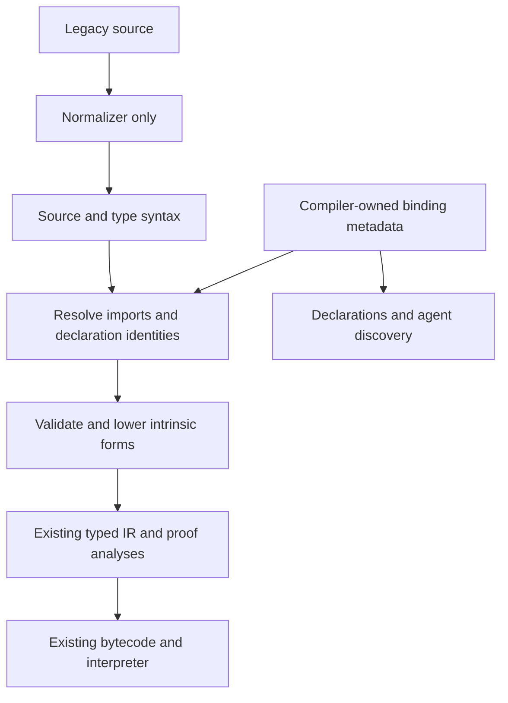

# TypeScript-compatible syntax design

Refreshed against `8b154522` (`v0.27.1`) on 2026-11-19.
Decision 1 retains option A, which the owner accepted on 2026-11-15.
The owner accepted Decision 2, option A, on 2026-11-19 and authorized implementation of this plan.

## Goal Capsule

Authors can write the four accepted constructs with TypeScript grammar and receive ZTS's checked behavior.
The means are the helper interface in KTD1 (preserve option A).
This file remains the plan authority for the syntax migration.

Decision 2 authorizes the profile changes and a new recording window.
The completed restrictions plan supplies the baseline, not migration authority.
Work remains on local `main`, with one local commit per isolated unit and no push or deployment.
The implementing agent owns compiler work; the owner runs the authorized model recording; the implementing agent publishes evidence afterward.

The migration stops if it needs broader pattern semantics, runtime builders, a second execution path, or weaker proof checks.
It also stops if a required binding or nominal identity cannot be resolved safely.

---

## Product Contract

### Summary and problem frame

The accepted interface replaces custom declaration keywords and control syntax with standard declarations and imported calls.
ZTS remains a restricted language with its own semantics. General TypeScript runtime compatibility remains outside this plan.

The November 15 proposal predates the completed restrictions work.
Its construction, import, presence-pattern, declaration-generation, and recording assumptions need correction before implementation.

### Current baseline

| Area | Current behavior | Consequence for this plan |
| --- | --- | --- |
| Release | `v0.27.1`, commit `8b154522` | Earlier test results do not validate this migration |
| Restrictions | The enforcement plan closed at `9ca7af85` | `test-ts-restrictions` must change with every deliberate admission change |
| Evidence | Corpus `af0f4c4f`; convergence `5b7cb98c`; coverage `3712da9b` | These artifacts describe the enforced November 19 profile |
| Declarations | `type` is ZTS050; `declare` and type-position `typeof` are refused | The accepted forms require narrow, approved grammar changes |
| Intrinsic names | `match` and `assert` are reserved value names under ZTS067 | Named imports need deliberate binding rules |
| Nominal construction | Annotated declarations brand raw values; constructor calls are ZTS214 | Migration must replace annotated construction, not existing constructor calls |
| Patterns | A field `_` rejects `undefined`; an array `_` accepts any element | `P.present` must retain defined-value semantics |
| Binding metadata | `type_exports` publishes names; type meaning lives separately | A name alone cannot establish intrinsic or type authority |
| Declarations for editors | `generateTypeDefs` does not emit declarations from `type_exports` | The new core surface needs an explicit declaration projection |

### Decision 1: accepted helper interface

Option A is session-settled: user-approved.
The rejected alternative was native `switch`/`if` with helper functions for values.
The accepted direction retains pattern expressions and checked assertions while changing their source forms.
It governs R1 through R8 below.

The following snippets describe authoring grammar, not compiler implementation.
The proposed module is `zttp:core`; it does not exist in the current registry.

| Existing form | Accepted target |
| --- | --- |
| `structural Point = { x: number; y: number };` | `type Point = { x: number; y: number };` |
| `nominal UserId = string;` | `declare const userIdBrand: unique symbol;` followed by `type UserId = Nominal<string, typeof userIdBrand>;` |
| `const id: UserId = "u1";` | `const id: UserId = nominal<UserId>("u1");` |
| `match (command) { ... }` | `match(command).with(pattern, callback).exhaustive()` |
| `assert predicate;` | `assert(predicate);` |

`Nominal` is a type-only import. `nominal`, `match`, `assert`, and `P` are compiler-owned intrinsic imports.
An alias import retains the same authority. The import's local spelling does not supply that authority.
`Proof` and `Effects` remain ambient and keep their current meaning.

### Requirements

| ID | Required outcome |
| --- | --- |
| R1 | Standard `type` declarations preserve transparent aliases, generics, recursion, export behavior, source spans, and declaration checks |
| R2 | Unique-symbol declarations create type identities only; separate declarations stay distinct across modules, including equal local spellings |
| R3 | `Nominal<Base, Identity>` admits `string`, `number`, or `boolean`; the recognized `nominal<T>(value)` checks the base and preserves the value |
| R4 | Fluent matching preserves current patterns, coverage, narrowing, order, faults, and selected-arm execution |
| R5 | The imported one-argument assertion preserves forward narrowing and invariant faults; expected failures continue to use explicit returns |
| R6 | Recognition uses resolved module, export, and binding identity; unresolved or escaped intrinsic forms are refused before execution |
| R7 | Labels, source-exact marks, effects, captures, and proof obligations survive lowering; declarations for editors add no proof facts |
| R8 | Normalization, diagnostics, discovery, generated declarations, examples, and documentation describe the same final source forms |

### Pattern and callback contract

The subject remains an identifier or member path.
Calls, indexes, and optional paths do not become admitted subjects through this migration.
Each complete chain evaluates its subject once and runs only the selected callback body.

The callback parameter names the narrowed subject inside its arm.
An omitted parameter means that the arm does not read that subject.
Current duplicate, reserved-name, shadowing, callback-annotation, and captured-write restrictions continue to apply.
Sibling callbacks may reuse parameter names where the current scope rules permit it.

| Current pattern | Target spelling and meaning |
| --- | --- |
| Literal | `.with("value", callback)` |
| Record discriminant | `.with({ kind: "echo" }, callback)` |
| Nested record or array | `.with({ pair: [0, P.any] }, callback)` |
| Exact-length array | `.with([P.any, P.any], callback)` |
| Top-level type test | `P.boolean`, `P.number`, `P.string`, `P.array`, `P.Dict`, or `P.Bytes` |
| Record field `_` | `P.present`: the field value must differ from `undefined`; `null` passes |
| Record field binding | Omit its test and read the field through the narrowed callback parameter |
| Default arm | Final `.otherwise(callback)` |

`P.any` is an unconstrained array position. The six type descriptors remain top-level tests only.
A missing field and a field holding `undefined` both fail `P.present`.
The earlier proposal incorrectly promised own-property presence, including `undefined`; that promise does not match the current implementation.
True own-property matching would require a separate semantic change and is outside this migration.

Closed coverage ends with `.exhaustive()`. Open domains require `.otherwise(...)`.
Missing cases retain the existing coverage errors and witnesses, including ZTS205 and ZTS603 where applicable.
Duplicate or unreachable arms remain errors under ZTS216; a covered closed match cannot gain an extra default.
Patterns contain literal data and recognized descriptors, not effectful computations.

### Scope boundaries

The target keeps the interpreter, bytecode execution model, and independent proof kernel.
It adds no runtime matcher builder, general symbol values, general ambient declarations, arbitrary type queries, or additional pattern forms.
Direct re-export remains refused; importing the original declaration or exporting a declared wrapper remains the current rule.

The completed fallback-assert repair remains in place at `5707ae91`.
The helper call has exactly one argument and one standalone-call context.
No fallback overload is planned.

---

## Planning Contract

### Key technical decisions

KTD1 (preserve option A), session-settled: user-approved.
The accepted source forms above remain the direction; this refresh does not reopen native control flow as the replacement.

KTD2 (keep Zig metadata authoritative).
Extend the existing binding registry with an explicit compile-time intrinsic category.
Do not create a second registry or native runtime stubs for values that must disappear during lowering.
The declaration file is an external TypeScript projection; ZTS must not ingest it as proof authority.

KTD3 (resolve brands by declaration identity).
A brand key comes from the resolved module and unique-symbol declaration binding, not the local alias name.
Identity must survive copying, import renaming, and aliases without merging independent declarations.
General type queries and general `declare` forms stay refused.

KTD4 (lower before consumers interpret calls).
A shared frontend lowering boundary must cover direct checking, graph checking, compilation, serving, and analysis tools.
It validates intrinsic identity and call shape before any consumer can generate bytecode or grant proof facts.
Match and assertion lowering reuse `match_expr`, `match_arm`, and `assert_stmt` behavior.
Any surviving, unresolved intrinsic call fails closed.

KTD5 (preserve current pattern semantics).
`P.present` lowers to the existing defined-value test.
The callback parameter receives its narrowed type before its body is checked.
Lowering retains declaration identities and source locations rather than matching captures by name.

KTD6 (separate migration from execution admission).
The existing normalizer may recognize legacy source solely to produce the target forms.
After cutover, ordinary checking, compilation, and serving refuse the legacy forms.
A failed or ambiguous rewrite leaves the input unchanged and reports the unresolved identity.
No new public compatibility mode or permanent second source dialect is planned.

D-016 (all executable source passes admission) restricts raw parser entries.
The normalizer first uses admission refusal evidence to build safe rewrites.
If identity-safe rewriting needs another raw parser entry, the executor stops for an owner-approved superseding decision before cutover.

### High-level technical design

This diagram shows ownership and required ordering. It does not prescribe implementation code.

The binding metadata belongs below the frontend lowering code in the existing layer structure.
A small descriptor owner and a shared lowering owner avoid a dependency cycle between builtin modules and the type checker.
A `.d.ts` body cannot substitute for either owner.

### Decision 2: implementation authorization

Decision 2 is session-settled: user-approved on 2026-11-19.
Option A, accepted: authorize this plan's narrow source-profile changes and one new batched recording window under D-012.
D-012 means model-visible changes wait for an authorized re-record window.
Option B, not selected: retain the refreshed plan and defer source changes.

Option A authorizes revising `docs/ts-restrictions.md` and `docs/spec/zts-model-1.md` for the accepted surface.
It also authorizes the bounded transition and owner recording described in U8 (close evidence for the migrated profile).
It does not authorize a push, deployment, broader TypeScript support, or rewriting old empirical recordings.
The former restrictions window closed with U7; its approval does not carry into this migration.

### Execution constraints

Units below belong to this syntax plan only. Their numbers do not refer to the completed restrictions plan.
Units run in dependency order because they share parser, checker, and metadata files.
The main agent plans, reviews, and verifies; Sol agents use high effort for bounded implementation units.
Budgets are hard turn limits, not duration estimates. At a limit, an executor returns changed files, checks, and open items.

During the approved transition, the restriction reference and its probes must describe each actual admission change together.
The transition ends at U6 (complete normalization and source cutover), with one canonical source form per concept.
No stage may hide newly accepted forms from the authoritative restriction gate.

---

## Implementation Units

### U1. Capture the current behavior and migration inputs

Covers R1 through R8 and KTD1 (preserve option A). Depends on Decision 2.
Files: `packages/tools/src/precompile_check_tests.zig`, `packages/zts/src/root.zig`, relevant existing analyzer and interpreter suites, and ignored `demos/typescript-syntax-study/` artifacts.
The executor records the baseline revision and public outputs before source changes.
The executor records which frozen tasks the current profile refuses before the first model-visible change.
The consumer inventory includes packages, examples, templates, shell fixtures, generated documentation, and agent prompts.

Test scenarios compare values, diagnostics, labels, effects, faults, and proof verdicts for the admitted forms.
Cases include a captured secret, a varying capability in a selected arm, optional fields, exact arrays, aliases, and separate modules with equal brand names.
The tests assert current behavior before replacement; historical recordings remain unchanged.

A declaration-only study checks the complete accepted interface with external TypeScript before frontend work starts.
Cases cover nested records, optional fields, exact arrays, binding-only records, split finite coverage, incomplete matches, brands, and assertion narrowing.
Positive programs must pass; each negative case must produce its expected type error.
The executor records the compiler version and exact results.
Acceptance: the baseline is attributable, every changed form has a public observation, and the declaration contract passes before U2 starts.
Budget: 12 turns. Checks: `test-zts`, `test-precompile`, `test-flow-census`, and external TypeScript checks.

### U2. Add intrinsic metadata and external declarations

Covers R2, R3, R5, R6, and R8; uses KTD2 (keep Zig metadata authoritative). Depends on U1.
Files: `packages/zttp-sdk/src/binding.zig`, `packages/zttp-sdk/src/descriptors.zig`, `packages/zts/src/module_binding.zig`, `packages/zts/src/builtin_modules.zig`, and `packages/tools/src/precompile_check.zig`.
A proposed `packages/zts/src/core_intrinsics.zig` owns the core descriptors without importing higher frontend layers.
The registry distinguishes type exports, compile-time intrinsic values, and runtime exports.
The declaration generator projects the complete proposed core surface from compiler-owned data.

Test scenarios cover renamed imports, type/value namespace mistakes, unregistered exports, descriptor escape, and a same-spelling foreign export.
Generated declarations cover core types and descriptors as well as functions; a published name alone is insufficient.
Acceptance: no runtime factory or placeholder function can materialize an intrinsic value.
Budget: 18 turns. Checks: `test-module-governance`, `test-zts-cli`, `test-contract-golden`, and the boundary checks in the verification table.

### U3. Admit aliases and explicit nominal construction

Covers R1 through R3 and R6; uses KTD1 (preserve option A) and KTD3 (resolve brands by declaration identity). Depends on U2.
Files: parser type-syntax files, `type_syntax_lowering.zig`, `type_env.zig`, `type_pool.zig`, `type_names.zig`, `import_signatures.zig`, `type_checker.zig`, and associated public checks.
The narrow unique-symbol declaration creates no runtime value or initializer requirement.
The permitted type query resolves only a brand declaration.
The recognized constructor requires one explicit, resolved nominal type argument and one value of its exact scalar base.

Test scenarios reject raw arguments to nominal parameters, wrong bases, unresolved identities, mixed brands, and runtime reads of brand declarations.
Separate declarations remain distinct across modules; two aliases of one declaration remain compatible.
Legacy annotated construction remains accepted during this unit.
Existing annotated construction must migrate before implicit branding is disabled at U6 (complete normalization and source cutover).
Acceptance: aliases stay transparent, brand identity survives import transport, and construction preserves values and labels.
Budget: 24 turns. Checks: `test-zts`, `test-ts-restrictions`, `test-precompile`, and `test-flow-census`.

### U4. Lower imported invariant assertions

Covers R5 through R7; uses KTD1 (preserve option A) and KTD4 (lower before consumers interpret calls). Depends on U3.
Files: `parser/parse.zig`, `module_facts.zig`, `source_frontend.zig`, `type_checker.zig`, and a proposed shared `intrinsic_lowering.zig` owner.
The binding check precedes lowering into the existing assertion node.
Only the recognized standalone, one-argument form gains assertion behavior.

Test scenarios cover an aliased import, a foreign same-spelling function, a false invariant, forward narrowing, a non-boolean condition, and a fallback argument.
A secret or varying read inside the condition must keep its current label and effect consequences.
Acceptance: checking, compilation, and serving agree, with original source locations and existing fault behavior.
Budget: 16 turns. Checks: `test-zts`, `test-precompile`, `test-server`, and `test-proof-swallow`.

### U5. Lower complete fluent match chains

Covers R4, R6, and R7; uses KTD1 (preserve option A), KTD4 (lower before consumers interpret calls), and KTD5 (preserve current pattern semantics).
Depends on U4 because the same lowering owner and binding checks apply.
Files: `intrinsic_lowering.zig`, parser IR and scope support, `type_checker.zig`, `match_analysis.zig`, `strict_checker.zig`, and `ir_identity.zig` where identity coverage needs extension.
Each callback gets an arm-local narrowed binding before body analysis.
Node tags must be checked before using non-validating IR accessors.

Test scenarios cover all current pattern kinds, names and member paths, missing cases, unreachable arms, and exact callback result unions.
They also cover absent versus undefined fields, `null`, sibling parameter names, captured-write refusal, and a secret captured across an arm.
Partial or escaped builders, dynamic descriptors, nested type tests, and unsupported callback shapes must be refused.
Acceptance: only the selected arm runs, subject evaluation stays singular, and proof analyses see the existing match operations.
Budget: 28 turns. Checks: `test-zts`, `test-flow-census`, `test-precompile`, `test-proof-swallow`, and `test-contract-golden`.

### U6. Complete normalization and source cutover

Covers R1 through R8; uses KTD1 (preserve option A) and KTD6 (separate migration from execution admission). Depends on U5.
Files: `packages/tools/src/canonicalize.zig`, parser admission, `restriction_registry.zig`, `ts_restrictions_probes.zig`, the restriction gate, `docs/ts-restrictions.md`, and `docs/spec/zts-model-1.md`.
The normalizer rewrites old declarations, annotated construction, match arms, and assertions using resolved source identities.
Its repair path must retain admission refusal evidence instead of returning before legacy repairs can be built.
A value that already has the correct brand must not receive another constructor.
All executable consumers and fixtures migrate before old admission is removed.

Test scenarios include cross-file aliases, a mixed-form project during normalization, an unresolved import, and a second normalization pass.
An ambiguous rewrite reports a diagnostic and leaves the input unchanged.
Post-cutover checks refuse old forms and report repairs in the new grammar.
Acceptance: normalization is idempotent, current admission has one source form per concept, and the restriction census has positive and negative controls.
Budget: 24 turns. Checks: `test-canonicalize`, `test-ts-restrictions`, `test-agent-protocol`, `test-precompile`, and both CLI smoke steps.

### U7. Align authoring surfaces and website claims

Covers R8; uses KTD1 (preserve option A) and KTD2 (keep Zig metadata authoritative). Depends on U6.
Files: `example_registry.zig`, machine discovery and rule help, `packages/pi/src/skills/canonical-style.md`, relevant prompts, examples, user documentation, and generated module specifications.
The implementation reads the sibling website's `AGENTS.md` and `CLAUDE.md` before changing `../ZTTP-WEBSITE/static/index.html` or related claims.
Generated module artifacts come from bindings; they are not edited directly.

Test scenarios require CLI and agent discovery to agree about every new type, intrinsic, descriptor, and refusal.
External TypeScript checks cover construction, separate brands, narrowing, complete and incomplete matches, and forbidden assertion arguments.
The complete TypeScript cases from U1 now check the generated declarations, including nested, optional, tuple, and split-coverage patterns.
Acceptance: intended core examples type-check, ZTS retains its additional profile checks, and website claims distinguish development from release.
Budget: 16 turns. Checks: `test-zts-cli`, `test-agent-protocol`, `test-module-governance`, `test-contract-golden`, and sibling `deno task verify` with browser checks.

### U8. Close evidence for the migrated profile

Covers R7 and R8. Depends on U7 and the owner-authorized D-012 window from Decision 2.
Files: the recorded codegen corpus and pins, `policy-hash.txt`, published convergence and coverage artifacts, and their existing emitters.
The executor compares migrated-profile refusals with the frozen baseline from U1 (capture current behavior and migration inputs).
The owner re-records through the documented recorder; the executor does not repair empirical transcripts by hand.

The record follows the established order: corpus and pins, convergence, then coverage, with separate local commits.
Historical receipts keep their original provenance. Changed source, policy, and graph identity must not acquire unsupported cached proof authority.
Acceptance requires a green offline replay and the complete canonical gate; owner recording that has not run remains unfinished work.
Budget: 18 turns for executor work; owner recording is an explicit external prerequisite, not an estimated duration.

---

## Verification Contract

The following are required implementation checks, not results from this planning refresh.
Each named step runs unfiltered, and its exit status supplies the verdict.
New expected codes and repairs must come from the diagnostic catalog and restriction reference, not invented numbers.

| Check | Purpose and owning units |
| --- | --- |
| `zig build test-zts` | Parser, typing, interpreter, lowering, and public-source regression behavior in U1 through U6 |
| `zig build test-precompile` | Shared checking, graph imports, compilation, and diagnostic parity |
| `zig build test-ts-restrictions` | Refusal/admission rows, positive controls, probe completeness, and allowlist ratchets |
| `zig build test-canonicalize` | Legacy rewrite safety, cutover, and idempotence |
| `zig build test-flow-census` | Secret, credential, effect, and unknown-value verdict preservation |
| `zig build test-module-governance` | Exhaustive type, intrinsic, and runtime export classification |
| `zig build test-zts-layering` and `zig build test-module-boundary` | Layer direction and deliberate consumer access |
| `zig build test-proof-swallow` | New walks descend safely and do not discard verdict-affecting errors |
| `zig build test-contract-golden` and `zig build test-agent-protocol` | Public contracts, discovery, and machine-envelope behavior |
| `zig build test-expert-app` | Offline model replay after the authorized recording |
| `zig build test` and `zig build check-spine` | Aggregate repository behavior and structural contracts |
| `zig build test-zruntime`, `zig build smoke-v1`, and `zig build smoke-getting-started` | Standalone runtime and real CLI flows |
| `bash scripts/verify.sh` | Final full gate, including release, isolation, semantics, normalization, and formatting |
| External TypeScript checks | Positive core programs and negative type cases against emitted declarations |
| Sibling `deno task verify` and Playwright MCP | Website consistency and its changed user flow |

Before each fix, a public regression must fail for the original defect.
Boundary mutations must detect spoofed intrinsic authority, merged brand identities, eager arms, dropped labels, and vacuous restriction coverage.
Every surviving mutant needs a behavioral test or a recorded reason.
Performance and declaration-checking costs need measurement during implementation; this plan assigns no invented threshold.

---

## Definition of Done

Decision 2 is explicitly resolved before implementation starts.
All four target forms work through checking, compilation, serving, normalization, and agent discovery.
Intended external TypeScript examples pass while API misuse is rejected within the declaration contract.
The interpreter and proof kernel retain their execution model and checked meanings.

Every requirement has a public observation and an unfiltered owning gate.
All abandoned experiments and runtime placeholders are removed.
Legacy execution admission is removed, and unsafe normalization leaves the original source intact.
The authorized recording and evidence publication complete, with a green replay and full local gate.

Documentation and website claims match the checked implementation.
Local commits remain reviewable; temporary servers and browser sessions opened for verification are closed.
Implementation that awaits owner recording is not reported as complete.

---

## Appendix

### Source evidence for this refresh

`docs/plans/2026-11-15-ts-restrictions-enforcement-plan.md` records the completed U7 boundary and corpus commits.
`docs/decisions.md` defines D-012, D-016, and the interpreter-only execution decision.
`STRATEGY.md` keeps authoring improvements inside the restricted proof fence.

The parser, type-syntax store, type environment, checker, module facts, import signatures, and module metadata establish the frontend changes above.
`parser/codegen.zig` and the interpreter's record-field tests establish defined-value presence semantics.
`packages/zttp-sdk/src/binding.zig`, `descriptors.zig`, and `packages/tools/src/precompile_check.zig` establish the current export/declaration split.

Relevant implementation lessons are:

| Source under `docs/solutions/` | Constraint carried into this plan |
| --- | --- |
| `runtime-errors/an-optional-accessor-read-a-string-node-as-a-function-body.md` | Check node tags before non-validating accessors |
| `security-issues/a-module-level-declaration-carried-no-label-so-its-secret-proved-clean.md` | Preserve capture and declaration identities |
| `logic-errors/a-delta-against-the-row-hid-a-clock-read-behind-an-exempt-one.md` | Derive callback effects before joining the caller's row |
| `security-issues/an-untyped-file-import-launders-values-past-the-checks.md` | Refuse unresolved type and binding transport at the import boundary |
| `conventions/a-gate-can-be-non-vacuous-and-still-porous.md` | Check verdict coverage and faithful mutations, not input counts alone |

### Historical prototype evidence

The November 15 prototype used ignored files under `demos/typescript-syntax-study/` and TypeScript 7.0.2.
It checked basic aliases, brands, record-union matching, and assertion narrowing with declaration stubs only.
It did not check runtime integration, complete pattern typing, or the November 19 source profile.
No implementation test or prototype rerun supplied evidence for this refresh.
